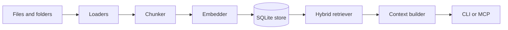

# ragkit

Local-first hybrid-RAG for your personal knowledge base. Indexes your docs,
notes, specs, and code repositories into SQLite (`sqlite-vec` + FTS5) with
Ollama embeddings, and serves them to AI agents over the Model Context Protocol
— 100% offline, no cloud.

## Pipeline



The core flow is intentionally simple: ingest local files, split them into
stable chunks, embed those chunks with Ollama, store everything in SQLite, then
blend vector and lexical retrieval when a query comes in.

## Local command aliases

After `npm install` and `npm run build`, you can avoid the long dist path and
invoke the CLI with either of these aliases:

```powershell
npm start -- init
npm run ragkit -- query "what am I looking for?"
```

`npm start` and `npm run ragkit` both point at the compiled CLI entrypoint in
`dist/cli/index.js`.

## Ollama setup

ragkit uses a local Ollama server for embeddings. If Ollama is not already
installed on your machine, set it up first:

1. Install Ollama for Windows from <https://ollama.com/download/windows>.
2. Start Ollama locally. You can launch the desktop app or run:

```powershell
ollama serve
```

3. Pull the embedding model used by ragkit:

```powershell
ollama pull nomic-embed-text
```

4. Verify the server is reachable:

```powershell
curl http://localhost:11434/api/tags
```

ragkit defaults to `http://localhost:11434`, so no env var is required unless
your Ollama server is running somewhere else.

## Offline guarantee

ragkit only talks to two local processes: SQLite on disk and Ollama on
`http://localhost:11434`. There is no hosted API, no sync service, and no
background upload path. If Ollama is unavailable, the CLI reports a local error
instead of reaching out to the network.

## Query explain mode

Use `ragkit query "..." --explain` when you want to see how the answer was
assembled. The explain output shows the dense and lexical candidate legs,
their ranks and raw scores, the RRF fusion step, and the final context budget
decisions that kept or dropped chunks.

## Retrieval eval

RAG quality is retrieval quality. `ragkit eval` scores the hybrid retriever
against a golden dataset so changes to chunking, fusion, or `topK` can be
compared with numbers instead of vibes:

```powershell
npm run ragkit -- eval evals/sample.golden.json --top-k 8
```

Relevance is anchored to the document **source**, not chunk ids — chunk ids
depend on the chunking strategy, so a source-anchored golden set stays valid
across chunkers and reindexes. Each case is
`{ id, query, relevantSources }`; the report gives Hit Rate, MRR, nDCG, and
context precision/recall per case plus an aggregate mean. The metrics are
deterministic and need no LLM, so `eval` can gate CI. Add `--json` for the full
machine-readable report.

## MCP server

`ragkit mcp` runs a Model Context Protocol server over stdio, exposing three
tools so an agent can search and read your indexed knowledge base:

- `search_context` — hybrid (vector + BM25) search returning cited passages.
- `list_collections` — available collections with document/chunk counts.
- `get_document` — full content of one indexed document by source path.

### Register with Claude

```powershell
claude mcp add --transport stdio ragkit --scope user -- npx -y ragkit mcp --collection pessoal
```

`--scope user` registers ragkit for every project (a transversal personal
knowledge base), not just the current repo. After registering, `/mcp` in Claude
should show `ragkit` as `connected`.

### JSON configuration

Equivalent `mcpServers` entry (e.g. `~/.claude.json` or a client's MCP config):

```json
{
  "mcpServers": {
    "ragkit": {
      "command": "npx",
      "args": ["-y", "ragkit", "mcp", "--collection", "pessoal"]
    }
  }
}
```

### Notes

- **stdout is protocol-only.** In `mcp` mode nothing but MCP frames is written
  to stdout; all diagnostics go to stderr. Do not pipe extra output into the
  process.
- **No hot reload.** Editing your files updates the index (`ragkit ingest`), but
  a running MCP client caches the tool list at connect time — restart the client
  (or its MCP connection) to pick up server changes.
- **Debugging a `disconnected` server:** run `ragkit mcp --collection <name>`
  directly in a terminal to see the real startup error on stderr.

See [`docs/mcp-setup.md`](docs/mcp-setup.md) for scopes, troubleshooting, and the
full protocol-purity contract.

## Embedding providers

Set `embeddings.provider` in `ragkit.config.ts`:

| provider | runs where | when to use it |
| --- | --- | --- |
| `ollama` (default) | local Ollama server | private, offline, real semantic embeddings |
| `openai` | any OpenAI-compatible `/v1/embeddings` API (OpenAI, LM Studio, vLLM...) | hosted or GPU-backed models; key read from the env var named in `apiKeyEnv` |
| `hash` | in-process, no model | tests, CI, demos, and as a lexical baseline to measure what a real model adds |

The vector table is 768-d, so every provider must return 768 dimensions
(`nomic-embed-text` does natively; `text-embedding-3-small` does via its
`dimensions` parameter, which ragkit always sends). After switching providers,
run `ragkit init --force` and re-ingest: vectors from different models are not
comparable.

## Retrieval strategies

Every retrieval command takes `--strategy` (or set `retrieval.strategy`):

| strategy | pipeline |
| --- | --- |
| `dense` | vector similarity only |
| `lexical` | BM25 over SQLite FTS5 only |
| `hybrid` (default) | both legs fused with Reciprocal Rank Fusion |
| `hybrid-rerank` | hybrid, then a reranker re-scores the fused candidate pool |

The built-in reranker (`term-coverage`) is offline and explainable: it rewards
chunks that cover *all* the question's content words, with a bonus for words
in the heading path. Any cross-encoder can be plugged in through the
`Reranker` interface in `src/core/reranker.ts`.

Compare them on your own golden set:

```bash
ragkit eval evals/my.golden.json --compare --top-k 5
```

[`examples/fastapi-docs`](examples/fastapi-docs) is a ready-made playground: a
pinned public corpus, a 25-question golden set, and baseline numbers.

## HTTP API

For clients that don't speak MCP (a web app, a Python agent, curl):

```bash
ragkit serve --port 8787            # binds 127.0.0.1
curl -s localhost:8787/search -d '{"query":"how do I add CORS?","topK":3,"strategy":"hybrid-rerank"}'
```

| route | purpose |
| --- | --- |
| `GET /health` | liveness (never authenticated) |
| `GET /collections` | collections with counts |
| `POST /search` | `{ query, topK?, strategy?, filter? }` → ranked results, context block, citations |
| `GET /documents?source=path.md` | chunks of one document |

Set `RAGKIT_API_TOKEN` to require `Authorization: Bearer <token>` on every
route except `/health`. [`examples/python`](examples/python) has a stdlib-only
client and a LangChain retriever adapter. See
[`docs/deploy.md`](docs/deploy.md) to run it on a server.

## Learning mode

- `ragkit chunks <file> [--size n --overlap n]` shows where a file would be
  split, with headings and token counts, without touching the database.
- `ragkit query "..." --explain` shows each leg's candidates, the RRF math,
  reranker decisions and the token-budget cuts.
- [`LEARNING.md`](LEARNING.md) is a guided tour of the codebase, with
  exercises.
